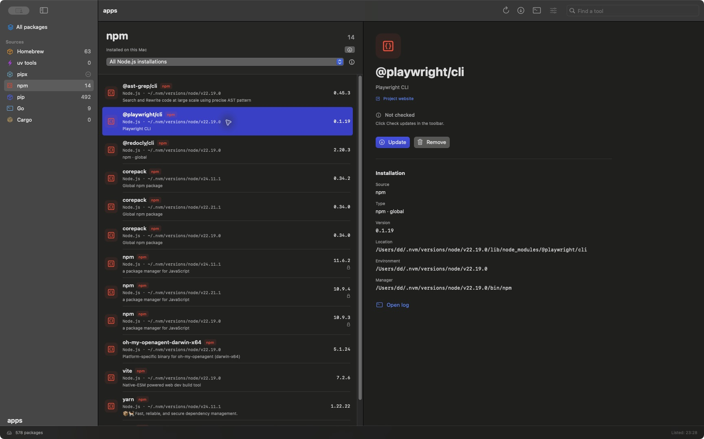
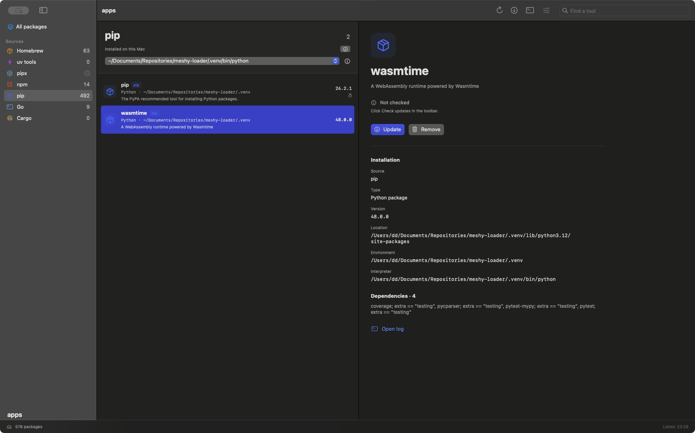
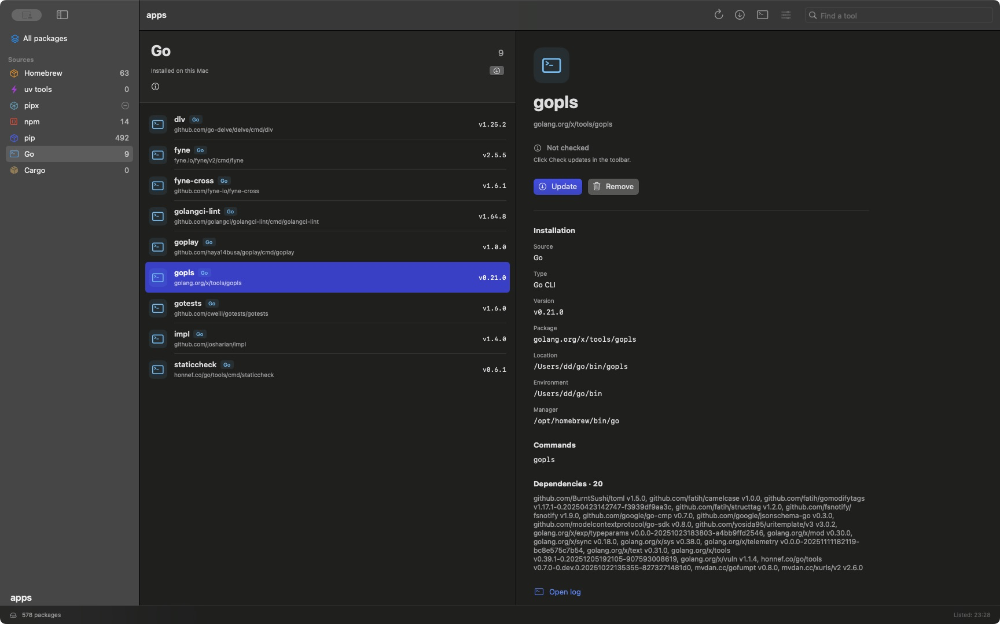

# apps

A free, native macOS app for keeping track of the CLI tools you and your agents install.
Browse packages across package managers, see which environment owns each installation, and update or remove individual tools from one window.

Built with SwiftUI for macOS 14+. Runs locally, with no account, server, analytics, or third-party Swift dependencies. Intended for personal use.



## What you can do

- Browse Homebrew, uv tools, pipx, npm, pip, Go, and Cargo from the sidebar.
- See packages from all discovered Node.js installations and Python environments together, with an environment label on every npm/pip row.
- Filter by environment, search by name or description, and show packages with a detected update.
- Inspect versions, installation paths, commands, dependencies, and operation restrictions.
- Update or uninstall one installation, with confirmation before removal and an operation log.
- Add a Python interpreter, project venv, Node.js installation, or custom Cargo installation root.

The interface defaults to English. Choose **Settings → Language → English / Russian** to change it; the preference is saved. Screenshots show the actual English interface. The sharing indicator in the upper-left corner is added by macOS during window capture; apps uses standard native window controls.

## Supported sources

| Source | Inventory | Update checks and operations |
| --- | --- | --- |
| Homebrew | Installed formulae and casks, including libraries | Checks the local catalog; updates and uninstalls individual packages |
| uv tools | Managed Python CLI environments | Native upgrade and uninstall; separate version checks are unavailable |
| pipx | Managed Python CLI environments | Native upgrade and uninstall; separate version checks are unavailable |
| npm | Global packages from each discovered Node.js installation | Registry checks; exact newer versions; scoped names supported |
| pip | Distributions in each discovered Python or venv | Index checks; upgrade/uninstall through that exact interpreter; protected packages remain restricted |
| Go | Executables in `GOBIN` or the first `GOPATH/bin` | Module version checks; verified staged builds; removal to Trash |
| Cargo | Binary crates tracked in the selected installation root | crates.io version checks; upgrade with recorded build options; source-qualified uninstall |

Go inventory requires Go 1.25+ for JSON build information. Python inventory requires Python 3.8+ and uses the standard library even when pip is absent. Each source needs its existing manager; apps does not install managers.

## Downloads

Download the ZIP for your Mac from [GitHub Releases](https://github.com/qdimka/apps/releases/latest): **arm64** for Apple Silicon or **x86_64** for Intel. Each release includes SHA256SUMS. Builds are ad hoc signed; see the signing limits below.

## GitHub Actions and releases

CI builds and checks Apple Silicon and Intel app bundles on branch pushes and pull requests.
Pushing a matching version tag such as `v0.4.0` publishes both app ZIPs and SHA256SUMS to
GitHub Releases after both builds pass. No Apple credentials are required for the ad hoc signed
bundles. See [CI setup, release steps, and signing limits](docs/releases.md).

The project is hosted at [qdimka/apps](https://github.com/qdimka/apps); build status and archives are available in its [Actions runs](https://github.com/qdimka/apps/actions).

## Build and run

Requirements: macOS 14+ and a Swift 6 toolchain from Xcode or Command Line Tools.

```sh
scripts/test.sh
scripts/build-app.sh
open dist/apps.app
```

The output is `dist/apps.app`, built for the current Mac's architecture. You can copy it to `~/Applications`. The build script applies an ad hoc signature for local use; a paid Apple Developer account is not required. This is not a notarized public distribution.

For a debug app bundle:

```sh
scripts/build-app.sh debug
```

Use the repository scripts on the development machine: they keep caches under `.build` and work around the detected Command Line Tools interface/module-map mismatch without modifying system files.

## Node.js and Python environments

Open **npm** or **pip** in the sidebar to see all discovered installations of that source. Identical package names in different environments remain separate rows. The filter above the list changes visibility, not the operation target: an action always uses the npm executable or Python interpreter belonging to its row.

npm discovery includes PATH and nvm installations. Python discovery includes standard locations, the Conda environment registry, and bounded searches under:

```text
~/Documents/Repositories    ~/Projects    ~/Developer    ~/code
~/.virtualenvs             ~/.local/share/virtualenvs    ~/.pyenv/versions
```

Standard and saved environments load first. Project discovery runs separately in the background and caches its results; new environments are added without clearing previous update checks. It stops at depth 5, 2,500 visited entries, or 150 environments. Dependency trees and directory symlinks are skipped. Use the source settings button in the toolbar to add installations outside those locations. A refresh discovers new environments; saved unavailable environments report their own error while healthy environments remain usable.



Conda-owned distributions, system packages, externally managed environments, and packages with unknown or foreign ownership are visible with an explanation of their restrictions. apps does not use `sudo` or `--break-system-packages`. Removing a pip distribution leaves its environment and unrelated dependencies in place; removing a uv/pipx tool removes its managed tool environment.

## Go and Rust tools

Go metadata is read with `go version -m -json`; discovered executables are not run. Local, development, replaced-module, or custom builds can be inspected but are restricted from automatic upgrades. A supported upgrade builds a newer version in a private staging directory, verifies the package/module/version, revalidates the original file, and replaces only that binary. Removal moves the selected owned binary to Trash, leaving Go and its module cache in place.



Cargo inventory uses `.crates2.json`. The default root comes from `CARGO_INSTALL_ROOT`, `CARGO_HOME`, or `~/.cargo`; choose a custom root in source settings if you use `--root` or `install.root`. crates.io upgrades preserve recorded binaries, features, profile, and target. Git, path, and alternative-registry installs are not converted into crates.io installs. Legacy entries without complete metadata are view-only. Project dependencies and rustup toolchains are outside the inventory.

## Refreshing and making changes

**Refresh** (`⌘R`) rereads installed packages. **Check updates** (`⇧⌘R`) explicitly queries supported sources; startup does not automatically check remote versions.

Homebrew checks use its existing local catalog. apps does not run `brew update` during a check because it can migrate installations. No detected update therefore does not prove that the installed version is the latest. uv/pipx checks remain unknown; their upgrade buttons invoke the manager's native upgrade operation. Incomplete pip index results also remain unverified.

Changes run one at a time as the current user. The adapter revalidates the selected installation before acting and rereads its inventory afterward, including after failure. Homebrew automatic removal of unrelated orphaned packages and automatic processing of installed dependents are disabled. A manager can still update dependencies required by the selected package.

Pip options that redirect the interpreter, destination, or target set are rejected, while registry configuration is retained. Protected distribution versions are constrained during dependency resolution. npm compares SemVer and installs an exact newer version; aliases, Git origins, and local links are not silently replaced with a registry package.

Go, Cargo, and pip checks have a 60-second overall deadline per manager/runtime. General command execution is limited to 30 minutes. Timeout or cancellation terminates the command's process group; partial changes are not rolled back. Output is available in the session log after the command finishes.

Manager configuration and process environment apply. Finder-launched apps can have a different environment from Terminal. Nonstandard npm/Python paths can be added in source settings; for other managers, launch `dist/apps.app/Contents/MacOS/apps` from Terminal with the intended PATH. Homebrew, uv, and pipx currently use one discovered installation each.

Not included: installing new packages, conda management, project `node_modules`, arbitrary manual binaries, full-disk environment discovery, bulk changes, scheduled updates, rollback, cleanup, or service management.

## Development documentation

- [Architecture and adapter contracts](docs/architecture.md)
- [Verification evidence and limitations](docs/validation.md)
- [Agent instructions](AGENTS.md)
- [Historical specifications and plans](docs/superpowers/README.md)
- [Screenshot provenance](docs/assets/README.md)

`AppsCoreChecks` is an executable check target, so full Xcode/XCTest is not required. Run `scripts/test.sh` for the suite. Optional inventory inspection reads real manager state without requesting upgrades or uninstalls:

```sh
scripts/swift-local.sh run AppsCoreChecks --inventory
```
